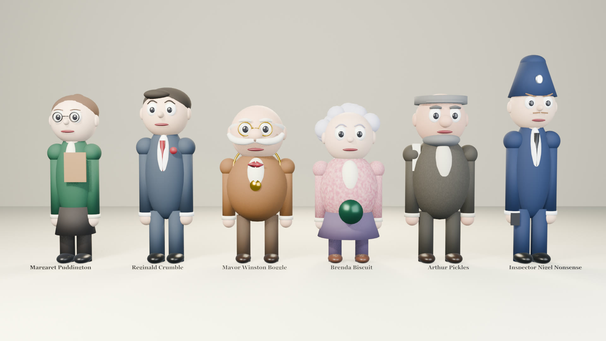

# Bobbington – Series Bible

> *A Town Full of Bad Decisions.*

Generated from `bobbington/bible.py` (single source of truth). Do not edit by hand – run `python -m bobbington.docs`.

## Series

- **Language:** en-GB
- **Humour:** Dry British comedy: sarcasm, absurd bureaucracy, eccentric characters, unexpected punchlines.
- **Audience:** International English-speaking comedy audience
- **Platforms:** TikTok (primary), Instagram Reels, YouTube Shorts

### Episode rules

- 60–75 seconds (never under 60, standard maximum 80)
- Every episode: beginning, conflict, escalation, twist, punchline
- Cold open: the hook line is spoken within the first 3 seconds
- At least two cast members per episode; Winston appears in every episode
- End on a button joke, then the series sting

## Visual identity

| Colour | Hex |
|---|---|
| burgundy | `#7A1F2B` |
| burgundy_dark | `#4E1219` |
| racing_green | `#1F4D3A` |
| green_dark | `#12301F` |
| cream | `#F3E9D2` |
| parchment | `#E6D5B0` |
| gold | `#C9A227` |
| gold_light | `#E4C766` |
| brick | `#9C4A33` |
| stone | `#B9AE9A` |
| slate | `#3F4650` |
| ink | `#1B1B1F` |
| sky_day | `#AFC8D8` |
| sky_dusk | `#E7A869` |

- Display type: Georgia Bold (fallback: serif bold) – headlines, title cards
- Subtitles: Arial Black / Arial Bold – burned-in subtitles, cream text, ink outline

| Coat of arms | Flag |
|---|---|
|  |  |

**Heraldry:** Burgundy shield, gold chevron, three cream teacups; crest: a traffic cone; supporters: two confused geese; motto scroll 'Ex Errore Gloria'.

Rendering: stylised 3D in Blender (EEVEE), rigged characters built from the specs below, 24 fps, 9:16. Every shot contains character animation (rig) – camera moves alone are never used as 'animation'.

## The town

**Bobbington** – Former market town in the fictional English county of Muddlesex. Motto: *Ex Errore Gloria* (Glory out of error). Founded 1347. Simulation start: 2,450 residents, £1,000,000 (fictional values).

### History

- 1347 – Founded when a cattle drover took a wrong turn and refused to admit it.
- 1612 – The market charter is granted; the charter is immediately lost, then found in a pie.
- 1789 – The Town Hall clock is installed facing a wall 'to protect it from the weather'.
- 1868 – The railway arrives. The station is built 400 yards from the nearest track.
- 1953 – Bobbington wins 'Most Improved Puddle' at the county fair. It has never been fixed.
- Today – Run by Mayor Winston Boggle, who considers every disaster a 'bold new chapter'.

### Traditions

- **The Great Puddle Day** (first Saturday of April): Residents gather to admire the historic puddle on Main Street. Nobody is allowed to fix it.
- **The Backwards Parade** (August bank holiday): Commemorates the founder's wrong turn. Everyone walks the route in reverse, including the band.
- **Mayor's Tea of Apology** (whenever necessary (monthly)): The Mayor serves tea to citizens affected by his latest decision. The tea is also a decision.
- **Biscuit Census** (every November): Brenda Biscuit counts the town's biscuits. The figures are disputed every year.

### Locations

- **Town Hall:** Grand Victorian Town Hall in red brick and cream stone; clock faces a wall.
- **Mayors Office:** Wood-panelled office, oversized desk, portrait of Winston painted by Winston.
- **Council Chamber:** Green leather benches, gold-framed motto, a gavel that is slightly too large.
- **Main Street:** Terraced shops with bay windows, bunting, the Historic Puddle.
- **Pub:** The Leaning Pickle – crooked Tudor pub run by Arthur Pickles.
- **Railway Station:** Bobbington Parkway – charming, 400 yards from any track.
- **Market Square:** Cobbles, a stone cross, Thursday market stalls.
- **Town Park:** Victoria Gardens – bandstand, duck pond, a bench nobody may sit on.
- **Police Station:** Blue lamp, one cell, one inspector, many questions.
- **Construction Sites:** Permanent cones; the town's most reliable growth industry.
- **Neighbourhoods:** Old Town, Puddle End, Crumble Heights, Biscuit Row

## Cast

### Mayor Winston Boggle – Mayor of Bobbington

Third-generation mayor (the first two were also Winston Boggle, which he claims is a coincidence). Studied 'Leadership and Elocution' by correspondence and still has the certificate framed twice. Believes that every catastrophe is a historic achievement waiting for a plaque.

- **Age:** 61
- **Personality:** extremely self-confident, stubborn, dramatic, sarcastic, frequently incompetent, convinced every mistake is a historic achievement
- **Speech:** Grand, pompous British delivery; long pauses for applause that never comes; dry put-downs.
- **Catchphrases:** “Historic.” · “Write that down, Margaret.” · “This will be remembered. Possibly fondly.” · “I have consulted myself, and I agree.”
- **Silhouette:** pear-shaped torso, short legs, oversized head, handlebar moustache wider than his face
- **Proportions:** height 1.62 m, head 0.36, build `round`
- **Voice:** Piper `en_GB-northern_english_male-medium`, length scale 1.08
- **Relationships:**
  - Margaret Puddington: relies on her completely; refuses to admit it
  - Reginald Crumble: sees him as a loyal admirer (he is not)
  - Brenda Biscuit: fears her ability to spread news faster than his press office
  - Arthur Pickles: drinks there 'for official research'
  - Inspector Nigel Nonsense: appointed him personally; regrets nothing, understands nothing

### Margaret Puddington – Town Clerk

Has run Bobbington's paperwork for 31 years and its actual government for 30. Owns 14 stamps, each with a different shade of disapproval. The only person who has read the town charter.

- **Age:** 54
- **Personality:** strict, precise, deadpan, secretly fond of Winston's chaos, unflappable
- **Speech:** Clipped Received Pronunciation; replies in procedural language; devastating one-word answers.
- **Catchphrases:** “Noted.” · “That requires a form.” · “Form 27B. In triplicate.” · “Mayor. No.”
- **Silhouette:** tall, narrow, perfectly upright; tight bun; clipboard always at chest height
- **Proportions:** height 1.7 m, head 0.3, build `tall_thin`
- **Voice:** Piper `en_GB-cori-medium`, length scale 0.98
- **Relationships:**
  - Mayor Winston Boggle: manages him like weather
  - Reginald Crumble: sees through him
  - Brenda Biscuit: the only source she cannot file
  - Arthur Pickles: mutual respect via silence
  - Inspector Nigel Nonsense: fills in his forms for him

### Reginald Crumble – Council Leader

Ambitious Council Leader who has prepared his acceptance speech for Mayor every year since 2009. Agrees with Winston in public and plots in the stationery cupboard.

- **Age:** 47
- **Personality:** ambitious, smarmy, opportunistic, cowardly when confronted, loves a slogan
- **Speech:** Smooth, oily, over-enunciated; turns every sentence into a campaign slogan.
- **Catchphrases:** “A bold vision, Mayor. Bold.” · “Purely in the public interest.” · “For the record — I was against it.”
- **Silhouette:** tall and narrow with a big chin and a too-perfect side parting
- **Proportions:** height 1.78 m, head 0.31, build `slim`
- **Voice:** Piper `en_GB-vctk-medium` speaker `p226`, length scale 1.0
- **Relationships:**
  - Mayor Winston Boggle: wants his job
  - Margaret Puddington: afraid of her
  - Brenda Biscuit: uses her to leak
  - Arthur Pickles: banned from the pub twice
  - Inspector Nigel Nonsense: tries to recruit him

### Brenda Biscuit – Local gossip

Self-appointed Head of Information. Knows everything that has happened in Bobbington and several things that have not. Runs the Biscuit Census and the unofficial town newsletter, 'Crumbs'.

- **Age:** 68
- **Personality:** nosy, warm, dramatic, fast-talking, always holding a biscuit tin
- **Speech:** Breathless, conspiratorial; starts every sentence with 'Well, I heard…'.
- **Catchphrases:** “Well, I heard…” · “I'm not one to gossip, but—” · “You didn't hear it from me. You heard it from me.”
- **Silhouette:** small and round with enormous lilac curls and a biscuit tin
- **Proportions:** height 1.55 m, head 0.33, build `round`
- **Voice:** Piper `en_GB-alba-medium`, length scale 0.92
- **Relationships:**
  - Mayor Winston Boggle: her favourite source of material
  - Margaret Puddington: her nemesis and best friend
  - Reginald Crumble: knows his secrets
  - Arthur Pickles: gossip exchange partner
  - Inspector Nigel Nonsense: solves his cases before he does

### Arthur Pickles – Landlord of The Leaning Pickle

Has run The Leaning Pickle for 35 years. Speaks in grunts, sighs and the occasional devastating sentence. Keeps a dartboard with the Mayor's face on it 'for tradition'.

- **Age:** 63
- **Personality:** grumpy, laconic, secretly kind, deeply sceptical of the council, polishes the same glass forever
- **Speech:** Low, slow, grumbling; very short sentences; longer silences.
- **Catchphrases:** “No.” · “We're closed. Emotionally.” · “That'll be four pounds and an apology.”
- **Silhouette:** broad barrel chest, flat cap, tea towel over one shoulder
- **Proportions:** height 1.74 m, head 0.34, build `broad`
- **Voice:** Piper `en_GB-vctk-medium` speaker `p270`, length scale 1.15
- **Relationships:**
  - Mayor Winston Boggle: tolerates him for the bar tab
  - Margaret Puddington: the only person he fears
  - Reginald Crumble: banned (twice)
  - Brenda Biscuit: trades gossip for crisps
  - Inspector Nigel Nonsense: serves him lemonade 'on duty'

### Inspector Nigel Nonsense – Police inspector (the only one)

Appointed by Winston after winning the 'Best Hat' contest. Has solved zero crimes and arrested himself once 'to test the system'. Takes notes constantly; none are legible.

- **Age:** 39
- **Personality:** confused, earnest, enthusiastic, literal-minded, accidentally right at the worst moment
- **Speech:** Eager, slightly too loud; misunderstands idioms; repeats the last word others said.
- **Catchphrases:** “Right. Wrong. Right?” · “I'm going to need everyone to remain… whatever you're doing.” · “Case closed. Which case?”
- **Silhouette:** very tall and thin, tall custodian helmet, notebook raised
- **Proportions:** height 1.84 m, head 0.3, build `lanky`
- **Voice:** Piper `en_GB-vctk-medium` speaker `p237`, length scale 0.95
- **Relationships:**
  - Mayor Winston Boggle: hero worship
  - Margaret Puddington: terrified of her forms
  - Reginald Crumble: thinks he's a suspect in everything (correct)
  - Brenda Biscuit: his best informant
  - Arthur Pickles: his 'safe house'

## Running gags

- The Town Hall clock faces the wall; characters check the time on it anyway.
- Margaret produces the exact form needed for any absurd situation.
- Reginald says 'For the record — I was against it' after every disaster, even ones he proposed.
- Brenda already knows the news before it is announced.
- Nigel arrests the wrong object (a bench, a goose, a puddle).
- Arthur's pub chalkboard comments on the episode's disaster.
- Winston unveils a commemorative plaque for every mistake.

## Audio identity

- **theme:** Pompous brass-band style fanfare in B-flat major, 4 bars, then a deflating trombone 'wah-wah'
- **sting:** Two-note tuba button + teacup clink at the end of every episode
- **music_policy:** Only self-generated music (assets generated by bobbington/sound.py) or licensed tracks with licence file
- **ambience:** town_hall: room tone with ticking clock; pub: murmur and glasses; street: birds and distant traffic
